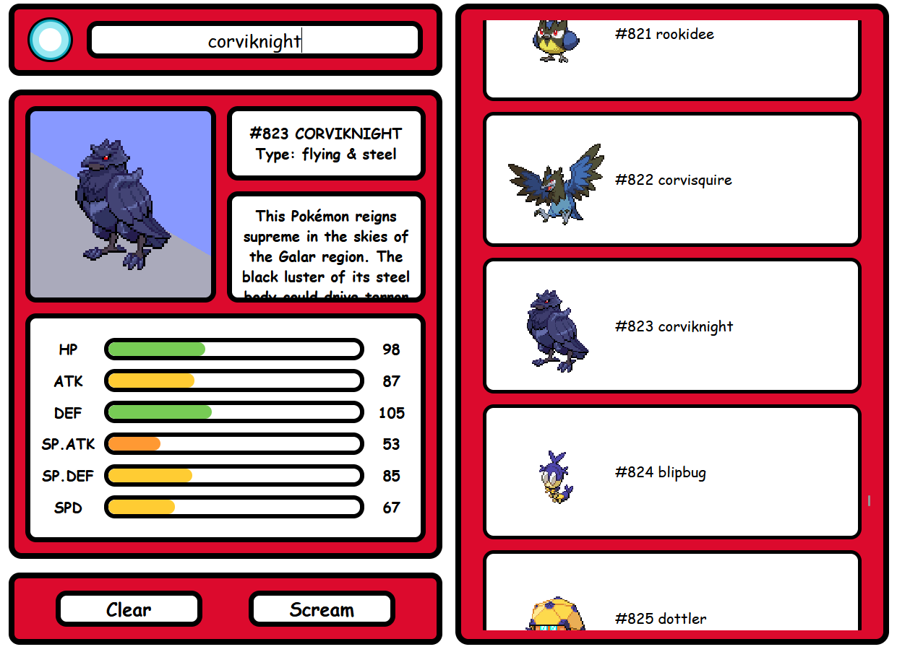

# PokeCheck

## Over het project
Pokécheck is een simpele PokéDex waar je snel informatie kan zoeken over een Pokémon. Het doel van PokeCheck is om een simpele en gebruiksvriendelijke Pokédex te maken waarmee je snel informatie over een specifieke Pokémon kunt opzoeken.

## Hoe gebruik je het?
Zoek een Pokémon door zijn naam of PokéDex nummer in de zoekbalk te typen. Nadat je een Pokémon hebt geselecteerd worden zijn naam, afbeelding en andere informatie weergegeven. Je kan ook de Pokémon van de lijst selecteren.

## Functies
- Pokémon zoeken op naam of Dex nummer
- Statistieken van Pokémon bekijken
- Afbeeldingen van Pokémon bekijken
- wisselen tussen normale en shiny Pokémon variant
- PokéDex descriptie zien van Pokémon
- Geluid van de Pokémon horen
- Pokémon zoeken in een lijst

## Welke API?
De PokeAPI haalt de informatie op van PokéAPI.co 
link van API: https://pokeapi.co/

## Gemaakt met

